# MudiScreen: a new interface for the touchscreen of the GL.iNet Mudi 7

<p align="center">
  
</p>

The GL.iNet Mudi 7 (GL-E5800) has a small touchscreen, driven by GL.iNet's
closed-source program `gl_screen`. MudiScreen takes its place. It shows what
the stock screen shows, adds a traffic analyzer, and opens the screen to
**apps**: any program that prints a little JSON can put a card, tiles and
whole pages on it, and the screen draws them in its own style.

It is one OpenWrt package, `mudi-screen`, installed with one command, and
the stock screen is always one command away.

**Tested:** Mudi 7 with GL firmware 4.10.0 and 4.10.2, in daily use.

> **Before you start.** MudiScreen replaces a part of the router's firmware.
> If it crashes three times in a row, GL.iNet's screen takes over until the
> next start, and `mudi-screen-mode stock` gives the screen back to it at any
> time. MudiScreen is a personal project and comes without any warranty (see
> [LICENSE](LICENSE)). It is not affiliated with GL.iNet.

## What it shows

<table>
  <tr>
    <td align="center">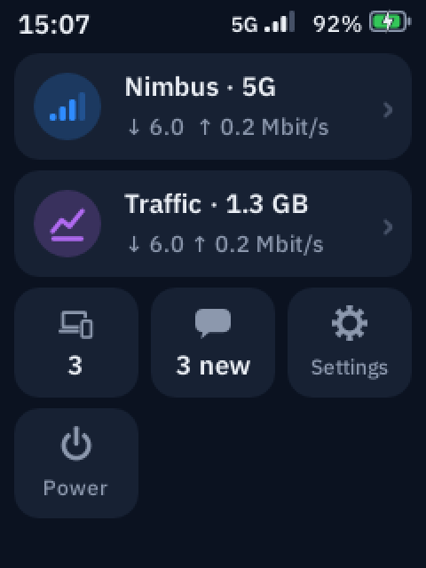<br><sub>Home: the network, cards and tiles of apps</sub></td>
    <td align="center">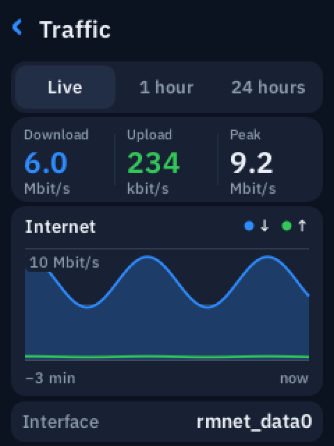<br><sub>Traffic: live, last hour, last 24 hours</sub></td>
    <td align="center">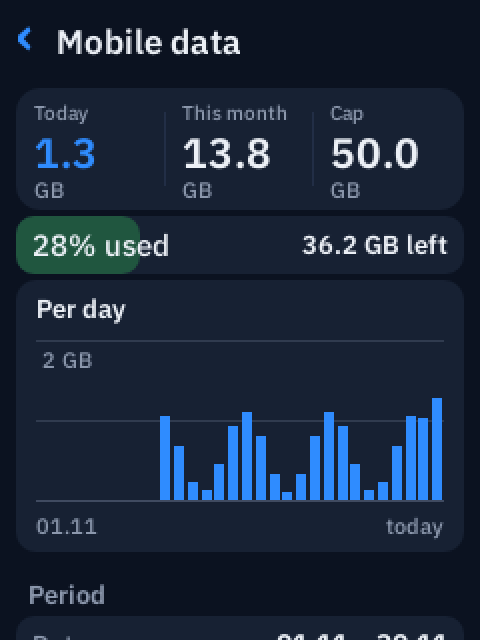<br><sub>Mobile data against a monthly cap</sub></td>
  </tr>
  <tr>
    <td align="center">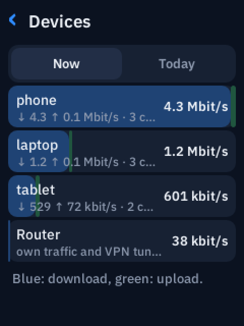<br><sub>Devices by speed or by the day's total</sub></td>
    <td align="center">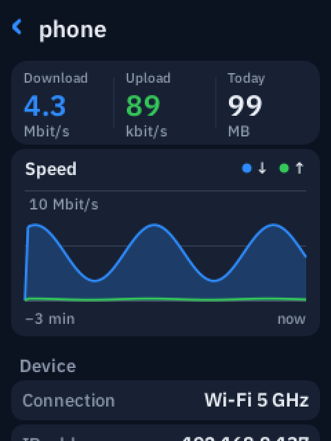<br><sub>One device: speed, apps, connections</sub></td>
    <td align="center">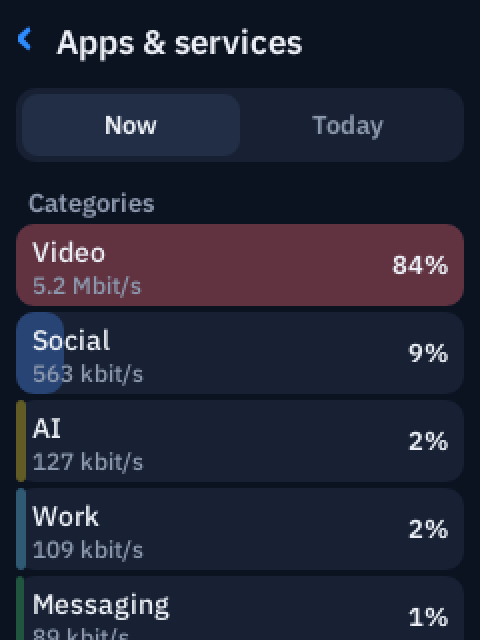<br><sub>Apps and services by category</sub></td>
  </tr>
  <tr>
    <td align="center">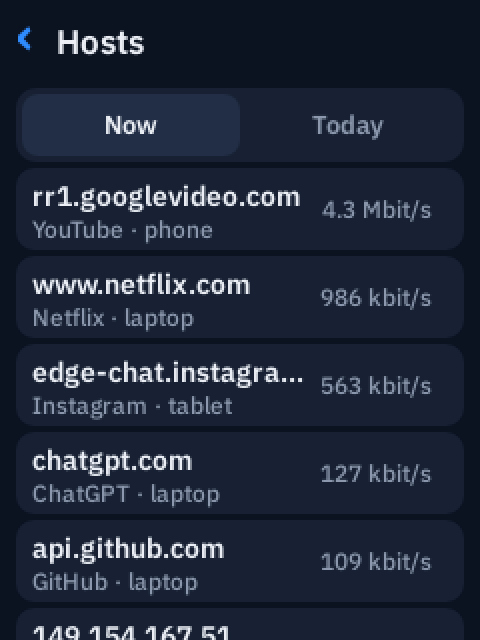<br><sub>Hosts, named from DNS and TLS</sub></td>
    <td align="center">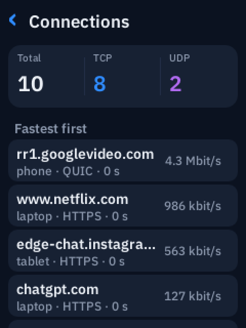<br><sub>Live connections</sub></td>
    <td align="center">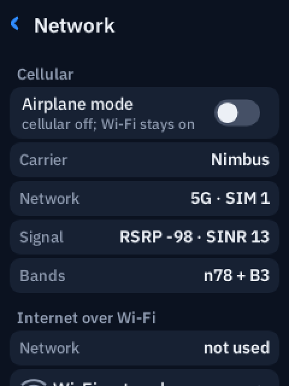<br><sub>The cellular network, airplane mode</sub></td>
  </tr>
  <tr>
    <td align="center">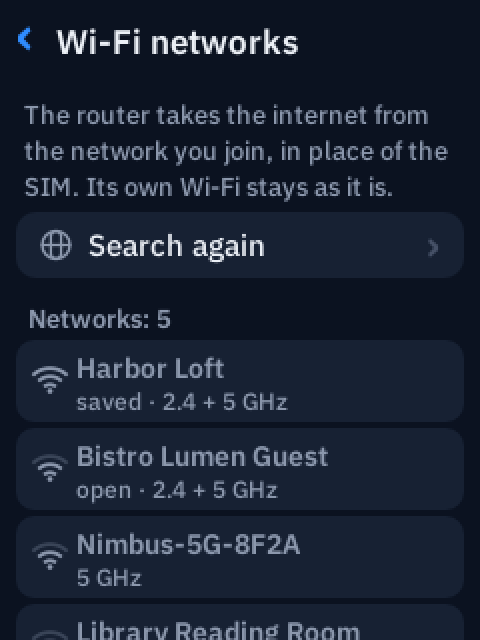<br><sub>Wi-Fi as the internet (repeater)</sub></td>
    <td align="center">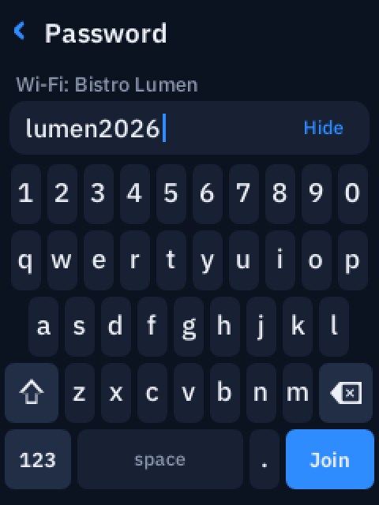<br><sub>The password, on the screen's keyboard</sub></td>
    <td align="center">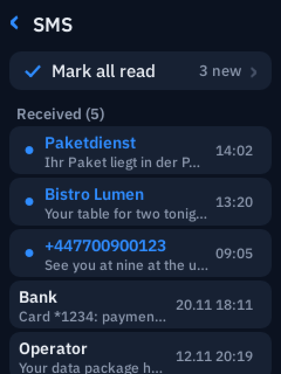<br><sub>The SMS inbox</sub></td>
  </tr>
  <tr>
    <td align="center">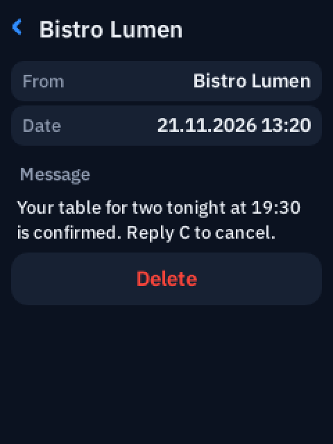<br><sub>A message</sub></td>
    <td align="center">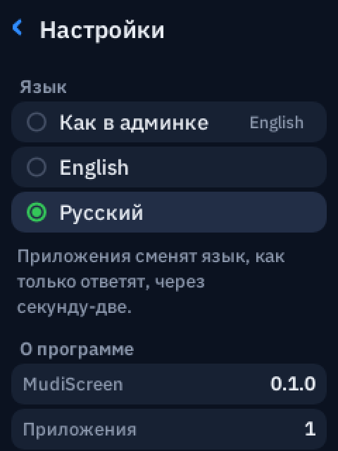<br><sub>Settings, here in Russian</sub></td>
    <td align="center">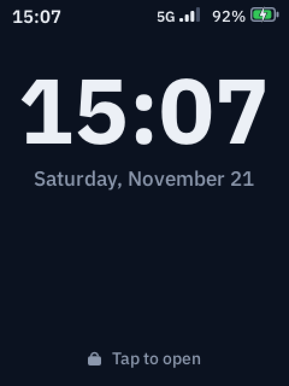<br><sub>The lock screen</sub></td>
  </tr>
  <tr>
    <td align="center">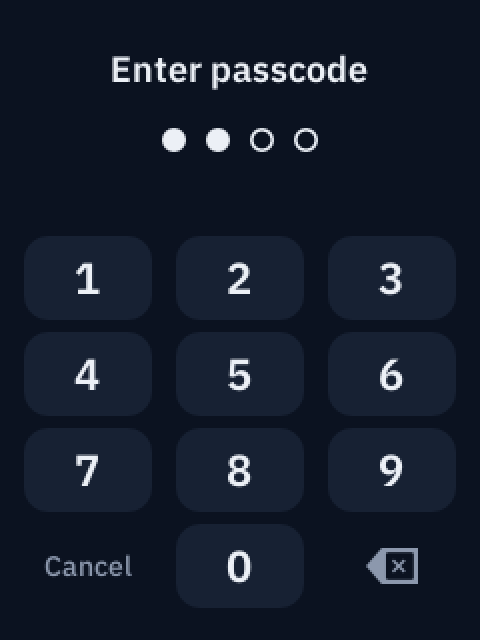<br><sub>GL's passcode</sub></td>
    <td align="center">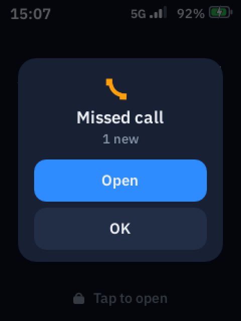<br><sub>A notice an app sent</sub></td>
    <td></td>
  </tr>
</table>

The pictures are the screen's own rendering of made-up data, pixel for
pixel what the panel shows (`sh docs/screenshots/make.sh`, see
[Building](#building)).

- **The router**, as on the stock screen: the lock screen with GL's
  passcode; the network (carrier, 4G or 5G, bands, signal, speed) and
  airplane mode; Wi-Fi as the internet in place of the SIM (GL's repeater):
  the networks around, and the password typed on the screen's own keyboard;
  battery and temperature; connected devices; the SMS inbox (read, mark
  read, delete); the power menu; brightness, auto-lock and the passcode from
  GL's Display settings. All of it through the same calls as GL's web admin,
  so the two agree. English and Russian, switched in Settings at once.
- **Traffic**, an analyzer that comes with it: the internet throughput live,
  for the last hour and the last 24 hours; mobile data today, for the month
  and per day against a cap you set, from the modem's own counter; devices
  by speed and by the day's total, each with its chart, apps and
  connections; apps and services by category (video, social, messaging…);
  hosts, live connections, protocols and DNS.
- **Apps** add everything else: cards, tiles, lines on the lock screen,
  status bar icons and pages with lists, toggles, bars and live charts, and
  notes on SMS and items in Settings. An app is a manifest and any
  executable that prints JSON: no Go, no rebuild of the screen. See
  [Apps](#apps).
- **Motion:** pages slide in and out, follow the finger when swiped back,
  scroll with momentum and rubber-band edges; dialogs and messages fade in.
  A page is drawn once into layers and every frame is put together from
  them, so motion runs at 50–60 frames a second (2–7 ms of work a frame).

## Install

**1. Log in to the router.** Connect your computer to the router's Wi-Fi or
LAN port, open a terminal (Terminal on macOS and Linux, PowerShell on
Windows) and run:

```sh
ssh root@192.168.8.1
```

The password is the router's admin password, the one of its web panel.

**2. Run the installer.**

```sh
wget -qO- https://github.com/xarvel/MudiScreen/releases/latest/download/install.sh | sh
```

The installer checks that the router is a Mudi 7, downloads the package,
checks its checksum, installs it and switches the touchscreen to MudiScreen.
That is all: the screen changes within a few seconds.

To go back to GL.iNet's screen, and to come back:

```sh
mudi-screen-mode stock     # GL.iNet's own screen
mudi-screen-mode custom    # MudiScreen
mudi-screen-mode status
```

The power menu of the screen (a long press of the power key) has "Stock
screen" too.

**Remove:** `opkg remove mudi-screen` gives the screen back to GL.iNet's
program first. The traffic history in `/etc/mudi-screen` stays; remove it
with `rm -r /etc/mudi-screen`.

### Settings

- **Language:** on the screen, Settings → Language: English, Russian, or
  the language of GL's web admin (the default, which follows a change
  there). Kept in `mudi-screen.main.lang`.
- **Passcode, brightness, auto-lock:** the screen settings of GL's web
  admin, as before. MudiScreen keeps them in GL's own settings, so the
  stock screen has them too.
- **Mobile data cap** and the first day of the billing period: on the
  screen, Traffic → Settings (`mudi-screen.traffic.cap_gb`, `cycle_day`).

### GL firmware updates

A firmware update with Keep Settings keeps MudiScreen: its files are listed
in `/lib/upgrade/keep.d/mudi-screen`. The new firmware enables GL.iNet's
screen again, so on the first start after an update it shows for a moment
until MudiScreen takes over. Like every package you installed yourself,
the package itself is forgotten by `opkg` in an update: before you update
or remove MudiScreen after a firmware update, run the installer again.

## The traffic analyzer

A collector service, `/etc/init.d/mudi-screen-traffic`, samples every 2
seconds whether the screen is on or not. It reads the kernel's connection
table (ctnetlink) and the interface counters, GL's list of clients, and the
modem's data counter. Names of hosts come from the DNS answers the router
gives its clients and from the server names in TLS ClientHellos, which a
kernel filter picks out on the LAN bridge and lets nothing else through. A
DNS answer counts only if the router sent it, and a ClientHello only if it
came from the device the router knows at its address, so that one device
cannot rename the connections of another. Devices with encrypted DNS of
their own (iCloud Private Relay, DNS over HTTPS) show fewer names.

The days (40 of them) are kept in `/etc/mudi-screen/traffic.json`, written
once an hour, at midnight and when the collector stops, with a copy beside
it.

**Privacy.** Everything stays on the router, and nothing of it shows on the
lock screen. Anyone who can unlock the screen, though, sees which names the
devices on the network looked up today. If that is not what you want:
`uci set mudi-screen.traffic.enabled=0; uci commit mudi-screen;
/etc/init.d/mudi-screen-traffic stop`.

The collector takes about 10 MB of memory and 1% of one core; the screen
about 15 MB, and about 6% of one core with the traffic page open.

## Apps

An app is a directory with a manifest and an executable:

```json
{"api": 1, "id": "load", "name": "Load", "order": 40, "command": "app.sh", "interval": 10}
```

The screen runs `app.sh status` every few seconds while it is on and reads
a *view*: a card, tiles, pages with items. A tap on an item runs
`app.sh action <id>`. The other way, the app calls the screen's ubus object
`mudi-screen` to be asked again at once (`refresh`), to show a notice
(`notify`) and take it back (`dismiss`), or to open one of its pages
(`show`). A text can hold a running time, which the screen keeps counting
up on its own: a call, a timer. The screen decides how
things look, so every app fits the same design. Texts are translated by
catalogs, which anyone can add for any app.

Apps live in `/usr/share/mudi-screen/apps` (from packages) and
`/etc/mudi-screen/apps` (your own). The traffic analyzer is such an app, and
[MudiVoLTE](https://github.com/xarvel/MudiVoLTE) brings one for its phone
line: an incoming call shows as a notice, and a call on the line with its
running time on the home screen, the lock screen and the status bar.
Everything about writing one, with a complete example in shell, is in
[docs/EXTENSIONS.md](docs/EXTENSIONS.md).

## How it works

- **Display:** `/dev/fb0`, 240×320, RGB565 little-endian. Only the rows that
  changed are written, and fbtft sends only those over SPI.
- **Touch:** `/dev/input/event0`, multitouch protocol B in screen pixels.
  Only the first finger counts.
- **Screen power:** `fb0/blank` puts the panel and the touch controller to
  sleep (no touches arrive while blanked). `bl_power` is what lpm-monitor
  reads to know whether the screen is on. `brightness` is GL's value + 20.
- **Power key:** GL's `lpm-monitor` reads the key and calls the ubus object
  `gl_screen` with `power key short press` / `power key long press`. The
  screen publishes that object as the stock one does, so a short press
  sleeps or wakes it, and a long press opens the power menu. Battery and
  charger events come the same way. As a fallback, the key itself is read
  passively (`/dev/input/event1`, no grab, debounced); it acts only if
  lpm-monitor stays silent for about a second.
- **Boot:** the firmware's boot animation (`screen_boot`, started in
  preinit) is ended the way `gl_screen` ends it.
- **Service:** `/etc/init.d/mudi-screen` runs a small supervisor,
  `/usr/libexec/mudi-screen/run`, which runs `/usr/bin/mudi-screen`. The
  supervisor keeps `gl_screen` off the display and gives the display to it
  after three quick crashes in a row, so that a broken build never leaves
  the screen dark; the next start tries again. Other programs that want the
  display for a while stop the service and start it again.
- **Fonts:** the firmware's own, IBM Plex Sans in
  `/etc/gl_screen/language/ttf`. The package brings none.
- **Keyboard:** a page of its own with five rows, digits on top. A key acts
  when the finger leaves the glass, and the finger can slide to the right
  key first; a bubble above it shows which. A password goes to GL's RPC on
  curl's stdin, never on a command line or into the log, and is dropped
  when the page closes or the screen locks.

One static Go binary of about 5 MB. Logs: `/tmp/mudi-screen.log` and
`/tmp/mudi-screen-traffic.log`; Go panics go to `logread`.

## Building

```sh
sh package/build.sh    # dist/: the .ipk, install.sh and SHA256SUMS (needs Go 1.24)
go vet ./... && go test ./...
```

To try a build on the router, copy the package over and install it:

```sh
ssh root@192.168.8.1 'cat > /tmp/mudi-screen.ipk' < dist/mudi-screen_*_aarch64_cortex-a53.ipk
ssh root@192.168.8.1 'sh -s /tmp/mudi-screen.ipk' < dist/install.sh
```

Firmware 4.10 has no `sftp-server`, so `scp` needs `-O`, or files go over
`cat` as above.

**Without the router**, any computer renders a page with made-up data:

```sh
go build -o mudi-screen .
./mudi-screen -fonts FONTS -apps apps -lang en -preview out.png -page home
```

`-page` takes `lock`, `pin`, `home`, `power`, `confirm`, `notify` or
`APP:PAGE` (`system:net`, `system:sms`, `traffic:main`, `traffic:mobile`…),
`-scroll N` scrolls, `-anim push|pop|up -progress 0.5` shows a frame of a
transition. `FONTS` is a directory with `default_medium.ttf`,
`default_semibold.ttf` and `default_bold.ttf`: a copy of the router's
`/etc/gl_screen/language/ttf`, or IBM Plex Sans Medium, SemiBold and Bold
from <https://github.com/IBM/plex> under those names.
`sh docs/screenshots/make.sh FONTS` renders the pictures of this README.

**On the router**, the screen takes commands for tests from a FIFO:
`echo 'tap 120 126' > /tmp/mudi-screen.ctl` (also `swipe DX DY`,
`drag X0 Y0 X1 Y1 MS`, `page home|lock|APP:PAGE`, `key short|long`, `wake`,
`sleep`). A screenshot is just `/dev/fb0`: 240×320 RGB565.

## Not done yet

- Pages the stock screen has and this one does not: sending SMS, the
  settings of the router's own Wi-Fi, switching the SIM, Wi-Fi QR codes.
  These would be apps too. Networks that want a user name (802.1X) are
  joined in the web admin.
- A QR code item for apps, so that an app can show a code without taking
  the display over.

## Thanks

No code was copied, but these saved a lot of guessing:

- [robavionix/gl-e5800-dashboard](https://github.com/robavionix/gl-e5800-dashboard):
  a Python replacement of `gl_screen` for the same router; the touch
  protocol, the three screen power controls, `cellular.network cell_info`
  on 4.10.
- [nazim/mudi7-tor](https://github.com/nazim/mudi7-tor): a Ghidra analysis
  of `gl_screen`: its RPC calls and its ubus `set` method.

## Support

MudiScreen is a personal project. If it is useful to you, you can support its
development in Bitcoin:

**BTC:** `bc1qcentspekpn7vjfcsdgw05vy33vxu3878tmkr84`


## License

[PolyForm Noncommercial 1.0.0](LICENSE): any noncommercial use, change and
sharing is fine; commercial use needs a separate license from the author.
The required notice and the licenses of the Go libraries in the binary are
in [NOTICE](NOTICE) and [package/THIRD_PARTY.md](package/THIRD_PARTY.md).
